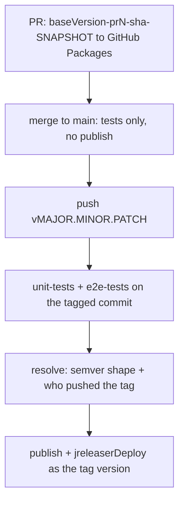

# Release process

Published coordinates are `id.veridian:signify:<version>`, and `<version>` is the release
tag. A release happens when someone pushes a semver tag; merging to `main` no longer
publishes anything.

## Where the version comes from

CI passes the tag to Gradle as `RELEASE_VERSION` with the leading `v` stripped, so pushing
`v0.1.3` publishes `0.1.3`. `baseVersion` in `gradle.properties` is only the seed for
snapshot builds now — nothing bumps it automatically any more.

| Condition | Effective version | Example |
| --- | --- | --- |
| `RELEASE_VERSION` set (tag push) | exactly that value | `0.1.3` |
| `PR_NUMBER` set | `baseVersion-pr<N>-<commit>-SNAPSHOT` | `0.1.2-pr7-378fa88-SNAPSHOT` |
| neither (local/dev) | `baseVersion-<commit>-SNAPSHOT` | `0.1.2-378fa88-SNAPSHOT` |

`<commit>` is the abbreviated HEAD commit hash from the `org.ajoberstar.grgit` plugin. CI
sets exactly one of the two variables, so a build is either a snapshot or a release — never
both.

Check what a build would publish:

```bash
./gradlew -q properties | grep '^version:'
```

## Releasing

```bash
git tag -a v0.1.3 -m "release 0.1.3"
git push origin refs/tags/v0.1.3
```

The tag points at the commit that gets published, so create it on `main` after the merge you
want to ship. Only `vMAJOR.MINOR.PATCH` tags release: the trigger glob is `v*` (Action
filters cannot express digit classes), and the `resolve` job re-checks the exact shape, so
`v0.1.3-rc1`, `v1`, or `version-3` run CI without publishing.

## Pipeline



### `snapshot` job (pull requests)

```bash
./gradlew build publishMavenJavaPublicationToGitHubPackagesRepository
```

Snapshots go to GitHub Packages only; the Maven Central snapshot repository is deliberately
left out so PR commits do not accumulate in Central.

### `resolve` job (tag pushes)

1. **Semver** — `GITHUB_REF_NAME` must match `^v[0-9]+\.[0-9]+\.[0-9]+$`; otherwise nothing
   is published and the run says so in the job summary.
2. **Author** — `gh api repos/<repo>/collaborators/<actor>/permission` must come back `write`
   or `admin`. This is the CI backstop for the tag ruleset below: a tag created by someone
   who cannot release stops here.
3. The release job runs only when both pass, and its steps publish
   `RELEASE_VERSION=<tag version>` from `build/staging-deploy` through JReleaser. The job runs
   in the `release` environment, so approvals can be required there.

No tag is created and no version is bumped by CI: the tag already exists, and the version is
the tag.

## Protecting tag creation

Workflow permissions cannot stop a tag from being created, so the gate is repository settings
plus the CI check above.

| Control | What it does | Where |
| --- | --- | --- |
| Tag ruleset (the real gate) | Blocks tag creation and deletion for everyone except the bypass list — add Admin and Maintain, or a named team. Applies to tags created through Releases too. | Settings → Rules → Rulesets → New ruleset → New tag ruleset, target `v*` |
| Semver name pattern | Rejects tags that are not `v<major>.<minor>.<patch>` at creation time, so a bad tag never reaches CI | Same ruleset, "Restrict tag names" → must match regex `^v[0-9]+\.[0-9]+\.[0-9]+$` |
| `main` protection | Tags should point at reviewed commits; branch protection keeps `main` itself protected. A ruleset cannot say "tags may only point at `main`", so keep the convention that release tags are created on `main` | Settings → Rules → rulesets targeting `main` |
| `release` environment | Adds a human approval step before anything is published, independent of who created the tag | Settings → Environments → `release` → required reviewers |
| CI author check | Backstop when the ruleset is bypassed, e.g. an integration that creates tags | `resolve` job, `Check who pushed the tag` |
| Role reality | Read-only collaborators and outside contributors cannot push tags to this repository at all; tags pushed to a fork do not run this workflow | — |

Ruleset JSON for import, equivalent to the two settings above:

```json
{
  "name": "Release tags",
  "target": "tag",
  "enforcement": "active",
  "conditions": { "ref_name": { "exclude": [], "include": ["v*"] } },
  "rules": [
    {
      "type": "tag_name_pattern",
      "parameters": {
        "name": "semver release tag",
        "operator": "regex",
        "pattern": "^v[0-9]+\\.[0-9]+\\.[0-9]+$",
        "description": "release tags must be vMAJOR.MINOR.PATCH"
      }
    },
    { "type": "creation" },
    { "type": "deletion" }
  ]
}
```

Then add the bypass actors in the UI (roles, teams, or apps) — `bypass_actors` is part of the
ruleset form, not the import file.

## Requirements

- Secrets used by the release job: `MAVEN_CENTRAL_GPG_KEY_BASE64`,
  `MAVEN_CENTRAL_GPG_PASSPHRASE`, `MAVEN_CENTRAL_OSSRH_USERNAME`,
  `MAVEN_CENTRAL_OSSRH_TOKEN`, signing key `3B36C37F3005FE8BB8B30DC26B12ADFA0BE0D092`. Keep
  them repository-scoped or move them onto the `release` environment so only approved runs can
  read them.
- Maven Central rejects snapshot versions, so a release must publish a clean version
  (JReleaser runs with `applyMavenCentralRules = true`), which the semver check guarantees.
- `GITHUB_TOKEN` needs `contents: read` and `packages: write` on the release job; it no longer
  pushes commits or tags.

## Notes

- Re-running a tag that was already published fails at `jreleaserDeploy` — neither registry
  accepts a duplicate version — so a release cannot be silently overwritten.
- Major and minor lines start by choosing the number to tag; `baseVersion` is advanced by hand
  only when you want the snapshot seed to move.
- `artifactId` is pinned to `signify` in `publish-common.gradle`; renaming it is a publication
  change, not a version change.
