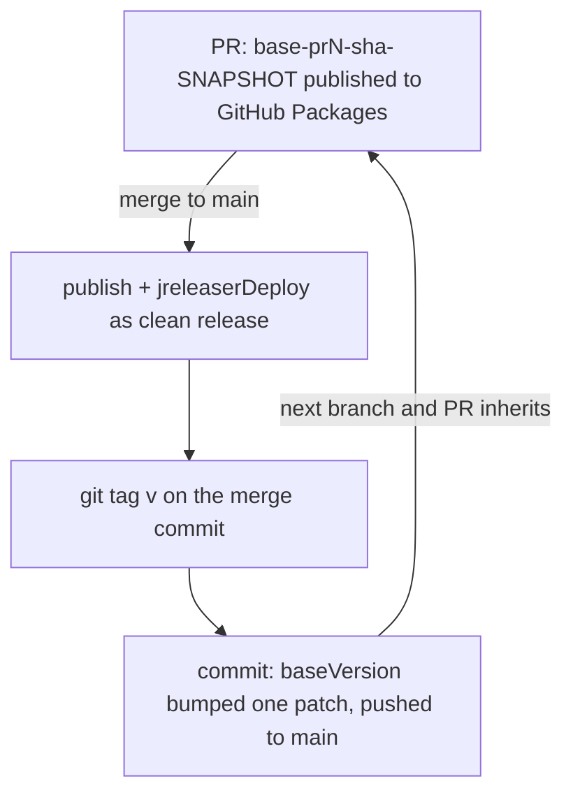

# Release process

Published coordinates are `id.veridian:signify:<version>`. The version is not
hardcoded in `build.gradle` any more: it is derived from one release line that CI
owns.

## Where the version comes from

`gradle.properties`:

```properties
baseVersion=0.1.2
```

That single value is the version the next merge to `main` will publish, and it is the
base PR snapshots inherit. `build.gradle` resolves the effective version:

| Condition | Effective version | Example |
| --- | --- | --- |
| `RELEASE_VERSION` set | exactly that value | `0.1.2` |
| `PR_NUMBER` set | `baseVersion-pr<N>-<commit>-SNAPSHOT` | `0.1.2-pr7-378fa88-SNAPSHOT` |
| neither (local/dev) | `baseVersion-<commit>-SNAPSHOT` | `0.1.2-378fa88-SNAPSHOT` |

`<commit>` is the abbreviated HEAD commit hash from the `org.ajoberstar.grgit` plugin.
CI sets exactly one of the two variables, so a build is either a snapshot or a release —
never both.

Check what a build would publish:

```bash
./gradlew -q properties | grep '^version:'
```

## Pipeline

`.github/workflows/gradle.yml` runs `unit-tests` and `e2e-tests` for every push and PR,
then branches:



### `snapshot` job (pull requests)

```bash
./gradlew build publishMavenJavaPublicationToGitHubPackagesRepository
```

`PR_NUMBER` is passed from `github.event.pull_request.number`. Snapshots go to GitHub
Packages only; the Maven Central snapshot repository is deliberately left out so PR
commits do not accumulate in Central.

### `release` job (pushes to `main`)

1. **Resolve version** — read `baseVersion`, validate it is `major.minor.patch`, compute
   the next patch, and skip everything if `v<base>` already exists.
2. **Publish** — `./gradlew build publish jreleaserDeploy` with `RELEASE_VERSION=<base>`.
   Artifacts are staged in `build/staging-deploy`, signed, and pushed to GitHub Packages
   plus Maven Central through JReleaser.
3. **Tag** — annotated tag `v<base>` on the commit that produced the release, pushed to
   the remote.
4. **Bump** — `baseVersion` incremented by one patch, committed as
   `chore: bump baseVersion to <next> [skip ci]` and pushed to `main`, so the next branch
   or PR already builds the next number.

Tag before bump, so the tag points at the release commit rather than the bump commit.

## Requirements

- `GITHUB_TOKEN` must have `contents: write` on the `release` job (set in the job's
  `permissions`) — needed to push the tag and the bump commit. Branch protection that
  forbids bot pushes or requires PRs will fail that step.
- The bump commit carries `[skip ci]`. GitHub Actions also does not re-trigger workflows
  from commits or tags pushed by `GITHUB_TOKEN`, so the release loop cannot recurse.
- Secrets used by the release job: `MAVEN_CENTRAL_GPG_KEY_BASE64`,
  `MAVEN_CENTRAL_GPG_PASSPHRASE`, `MAVEN_CENTRAL_OSSRH_USERNAME`,
  `MAVEN_CENTRAL_OSSRH_TOKEN`, signing key `3B36C37F3005FE8BB8B30DC26B12ADFA0BE0D092`.
- Maven Central rejects snapshot versions, so a release must publish a clean `baseVersion`
  (JReleaser runs with `applyMavenCentralRules = true`).

## Manual release

To publish a specific version outside CI:

```bash
RELEASE_VERSION=0.2.0 ./gradlew build publish jreleaserDeploy
git tag -a v0.2.0 -m "release 0.2.0"
git push origin refs/tags/v0.2.0
```

Then update `baseVersion` in `gradle.properties` by hand and commit it, otherwise the next
merge will re-release the same number.

## Notes

- Every merge to `main` produces a release and a tag, including documentation-only merges;
  add `paths-ignore` to the workflow if that noise matters.
- The bump is patch-only. Major and minor bumps are manual edits to `gradle.properties`.
- Publishing the same version twice is not possible on either registry; the existing-tag
  guard in the `release` job is what makes re-runs safe.
- `artifactId` is pinned to `signify` in `publish-common.gradle`; renaming it is a
  publication change, not a version change.
